<!--
  Door signs: open · opening soon · in preparation
  When a workshop project goes public, move it to "Out in the open" and link the repo.
  Banner: assets/banner.svg, generated by .github/banner/generate.js (see the comment at its top).
-->

  

I'm Florian, a full-stack developer in Nantes.

By day I write Java and Angular. In the evenings I build small tools for problems I actually have: recipes I save and never cook, concerts I hear about a week too late, a Wi-Fi connection that drops every time my phone wakes up.

Most of these projects get a short French word for a name, and stay private until they're worth showing.

### Now

Autumn 2026

- Building my portfolio: a slow scroll down through a European city at night, from the rooftops to the metro.
- Rewriting [Genesis](https://github.com/Florian-Sorin/genesis) from scratch, lighter this time.
- Next on the pile: *Crime and Punishment*.
- Still playing The Binding of Isaac. One more run.

### Out in the open

**[Genesis](https://github.com/Florian-Sorin/genesis)** 
A handful of Markdown contracts that keep an AI-assisted project on track when you switch models, tools or sessions. The agents keep the memory; the human makes the calls.

**[Balise](https://github.com/Florian-Sorin/balise)** · *beacon; also French for an HTML tag* 
Local-first network diagnostics for a home connection that keeps dropping. It watches, logs every incident, and changes nothing until the data says what's wrong.

### In the workshop

Private for now. Each one has a sign on the door.

| Project | What it's for | Sign |
| :-- | :-- | :-- |
| **Portfolio** | The night city above, turned into a website. | <code>opening&nbsp;soon</code> |
| **Mijote**  *to simmer* | Recipes you save, then actually cook. | <code>in&nbsp;preparation</code> |
| **Clairon**  *bugle* | Tells me when an artist I like plays somewhere I can realistically get to, with the trip priced in. | <code>in&nbsp;preparation</code> |
| **Virée**  *a night out* | What's on tonight in Nantes, pulled from open data and local agendas onto one map. | <code>in&nbsp;preparation</code> |
| **Rappeltout**  *remind-it-all* | A shared memory for a small household: chores, paperwork, the parcel to pick up before Friday. | <code>in&nbsp;preparation</code> |
| **Trame**  *a story's thread* | A writing tool that keeps track of characters, places and timelines without getting in the way of the writing. | <code>in&nbsp;preparation</code> |

### Tools

**By day:** Java · Spring Boot · Angular · TypeScript · GitLab CI · Docker · Kubernetes 
**After dark:** Nuxt · Vue · TypeScript · Tailwind · Node · Supabase · SQLite · Cloudflare

I studied machine learning. These days that mostly means working out where AI agents genuinely help in a codebase and where they just add noise. Genesis is where I write down the answers.

### Off-screen

- Fantasy, mostly: Tolkien, Robin Hobb, Stephen King's *Dark Tower*. Some philosophy, slowly.
- Football, and *Blue Lock* for the version where everyone on the pitch is an egoist.
- Cooking. Mijote is not a coincidence.
- Concerts, cinema, museums, theatre. Same goes for Clairon and Virée.
- Games, mostly on PC, headphones on. You may have noticed.

### Say hi

[LinkedIn](https://www.linkedin.com/in/florian-sorin-dev/) · the portfolio goes here once the lights are on.

<i>Terminus. Tout le monde descend.</i>

